<!--
  SEO metadata — Kubernetes ML Inference, LLM serving, model deployment
  title: Awesome Kubernetes ML Inference — LLM & Model Serving on Kubernetes (2026)
  description: The largest curated list of Kubernetes ML inference tools: 10 SaaS model-serving platforms (Vertex AI, SageMaker, Databricks) with pricing compared side by side, plus 22+ open-source LLM serving engines (vLLM, SGLang, KServe, Triton) sorted by GitHub_Stars.
  keywords: kubernetes ml inference, kubernetes machine learning inference, llm serving kubernetes, model serving kubernetes, llm inference platform, gpu inference kubernetes, kubernetes model deployment, kubernetes llm serving, vllm kubernetes, sglang, kserve, seldon, triton inference server, bentoml, ml inference saas, mlops platforms, ai inference pricing, scale to zero inference, gpu autoscaling, awesome list
  robots: index, follow
-->

  

# Awesome Kubernetes ML Inference 🚀 LLM & Model Serving on Kubernetes

  
  
  
  
  
  
  

## 🌐 Top Kubernetes ML Inference Ecosystem

**The curated list of Kubernetes ML inference platforms — SaaS model-serving products & open-source LLM serving projects, compared**  

*Focused on Model Serving, GPU Optimization & Production Inference at Scale*  

**Last updated: October 2026**

This repository tracks notable **SaaS platforms** and **open-source projects** for **Kubernetes ML inference** — the tooling layer that deploys, scales and serves machine learning models, from classical predictive models to large language models (LLMs), on Kubernetes with production-grade autoscaling, GPU optimization and intelligent request routing.

If you are searching for **LLM serving on Kubernetes**, **GPU inference servers**, or the **best model-serving platform** for your stack, start with the [SaaS comparison table](#saas-hosted-platforms) (prices and free tiers) and the [open-source star-ranked table](#open-source-github-projects) (vLLM, SGLang, KServe, Triton, BentoML and 18 more).

**Examples** include Google Vertex AI, AWS SageMaker, Azure Machine Learning, Databricks, Dataiku, DataRobot, H2O.ai, Domino Data Lab, Scale AI, and BentoML (the category leaders).

**Open-source emphasis**: This section is heavily expanded with every major active project for self-hosting, GPU-aware scheduling, and transparent inference infrastructure — ideal for ML engineers, platform teams, and organizations building vendor-neutral Kubernetes-native serving stacks.

Contributions welcome! Open a PR to add/update entries. Keep descriptions factual and link to official sites.

## 📑 Table of Contents

- [📊 Sector Overview & Market Dynamics](#sector-overview--market-dynamics)

- [☁️ SaaS/Hosted Platforms](#saas-hosted-platforms)

- [🧰 Open-Source GitHub Projects](#open-source-github-projects)

- [❓ Kubernetes ML Inference — Frequently Asked Questions](#kubernetes-ml-inference--frequently-asked-questions)

- [🤝 How to Contribute](#how-to-contribute)

- [⚠️ Disclaimer](#disclaimer)

## 📊 Sector Overview & Market Dynamics

The **model-serving platform market** was estimated at **$3.06B in 2025** and is forecast to grow at a **43.3% CAGR through 2030** (Technavio); the broader **AI inference market** it sits inside was valued at **$97.2B in 2024** growing at **17.5% CAGR** (Grand View Research), with the narrower MLOps tooling layer at **$2.2B in 2024** growing at **40.5% CAGR**.

The sector is **moderately fragmented — not winner-take-all**. Model serving alone is called fragmented by analysts, who track 21+ competing vendors, and open-source engines (vLLM, SGLang, KServe, Triton) fragment the serving layer further; concentration appears one level down, where AWS + Microsoft + Google hold ~**63%** of cloud infrastructure (Q3 2025, Synergy), making the hyperscalers the incumbent distribution channel rather than a single serving winner. Switching costs are sticky within deployments, but multi-framework support and cloud portability keep the software layer competitive.

## ☁️ SaaS/Hosted Platforms

Curated comparison of the leading hosted ML inference / MLOps platforms. All prices are USD unless noted and reflect publicly published rates (list prices, marketplace or procurement listings) as of **October 2026**. Rows are sorted by **company size (descending)** — latest reported revenue where public, otherwise latest disclosed valuation.

| Platform | 🏢 Company Size (revenue / valuation) | Description | 💲 Pricing (specific starting tier) | 🆓 Free Tier / Trial Limits |
|---|---|---|---|---|
| **[Google Vertex AI](https://cloud.google.com/vertex-ai)** | **$402.8B** FY2025 revenue (Alphabet); Google Cloud exited 2025 at a **$70B+** annual run rate | Google's end-to-end ML platform with Model Garden for open models, prediction endpoints, and Vertex AI Agent Builder. Strong integration with GKE for hybrid serving. | Custom prediction endpoints from **$0.077/hour** (`e2-standard-2` basic endpoint) + storage; managed online endpoints billed per node-hour. | Google Cloud **$300 credit for 90 days** (new accounts, applies to Vertex AI); no perpetual free prediction quota. |
| **[Databricks](https://www.databricks.com/)** | **$134B** valuation (Dec 2025, Series L); **$4.8B** revenue run rate | Unified analytics platform with Model Serving for ML models and LLMs, featuring auto-scaling, GPU optimization, and native MLflow integration. | Model Serving on a **T4 GPU = 10.48 DBU/hour**; at the published example rate of **$0.07/DBU** ≈ **$0.73/hour** DBU fee + cloud instance cost. | **Free Edition free forever** (fair-use): serverless-only compute, limited compute size, **no GPU serving**, capped endpoints. Work trial: **14 days, up to $400 credits**. |
| **[AWS SageMaker](https://aws.amazon.com/sagemaker/)** | **$128.7B** FY2025 revenue (AWS) | Fully managed ML platform with real-time inference endpoints, serverless inference, and asynchronous batch transform. Supports Triton, vLLM, and custom containers on EKS. | ML instances from **$0.05/hour** (`ml.t3.medium`); endpoint capacity billed per instance-hour, serverless inference per millisecond. | First **2 months**: **125 hours/month** of real-time inference on `ml.m5.xlarge`/`ml.m4.xlarge` **plus 150,000 seconds/month** serverless inference. |
| **[Azure Machine Learning](https://azure.microsoft.com/en-us/products/machine-learning/)** | **$75B+** FY2025 revenue (Microsoft Azure & other cloud services) | Microsoft's managed ML platform with managed online endpoints, batch inference, and Azure OpenAI Service integration. Native AKS integration for Kubernetes serving. | **$0 ML service surcharge** — you pay Azure compute only; e.g. Microsoft's own training example uses **$1.196/hour** for a `Standard_DS14_v2` VM. | **$200 Azure credit for 30 days** (new accounts, usable on Azure ML compute); no free-forever GPU/compute quota. |
| **[Scale AI](https://scale.com/)** | **~$29B** implied valuation (Jun 2025, Meta's $14.3B for 49%) | Data labeling and model evaluation platform with fine-tuning services and deployment support. | **Rapid self-labeling: $0.05 per labeling unit** after the free allowance (1 annotation = 1 unit); GenAI Platform/GenAI Data Engine priced by custom quote. | **Rapid: 200 free labeling units every month** (free forever); Scale product terms also allow time-boxed trial/evaluation access to GenAI Platform (duration set case-by-case). |
| **[DataRobot](https://www.datarobot.com/)** | **$6.3B** valuation (Jul 2021, Series G) | Automated machine learning platform with deployment, monitoring, and governance features for enterprise AI. | From **£20,000 per license/year** (UK public-sector G-Cloud marketplace listing); direct enterprise pricing is quote-based. | **14-day free trial** (G-Cloud listing); DataRobot docs also describe a **30-day** self-service trial with usage limits. |
| **[H2O.ai](https://h2o.ai/)** | **$1.7B** valuation (Nov 2021, Series E) | Open-source ML platform (with enterprise offerings) featuring Driverless AI for automated model building and deployment. | **H2O AI Cloud on AWS Marketplace: $225,000 per GPU / 12-month contract** (1–64 GPU deployments). | **H2O-3 open source free forever** (Apache 2.0, self-managed, unlimited local use); H2O AI Cloud commercial trial offered (quota not published). |
| **[Domino Data Lab](https://www.domino.ai/)** | **$915.9M** valuation (Aug 2025, Series F) | Enterprise MLOps platform for model development, deployment, and monitoring with reproducibility focus. | AWS Marketplace: **$50,000/year platform fee** + **$62,500/year for 5 practitioner licenses** (published components, before consumption charges). | **No free tier and no published trial** — enterprise-only; evaluation access is arranged via sales. |
| **[Dataiku](https://www.dataiku.com/)** | **$350M+** ARR (Oct 2025) | Enterprise AI platform with visual model development, deployment, and monitoring capabilities across cloud and on-prem environments. | No public list price; published **G-Cloud 14 reseller listing: £101,430 per instance** (Billigence Europe) — enterprise deals are quoted. | **Free Edition free forever** (self-installed, unlimited local use, no published numeric ceilings); Cloud trial **14 days**: 2 users, 1 API service, 4 CPUs, 32 GiB RAM. |
| **[BentoML](https://www.bentoml.com/)** | **$9M** seed (Jun 2023); acquired by **Modular** (Feb 2026, terms undisclosed) | Model serving framework (with hosted BentoCloud) offering adaptive batching, multi-model composition, and scale-to-zero. Python-first with Runner abstraction for custom inference logic. | **BentoCloud pay-as-you-go** (CPU/GPU node-hours, no public rate card since joining Modular in Feb 2026); the open-source framework itself costs **$0**. | **BentoML open source free forever** (Apache 2.0); hosted BentoCloud signup credit **$10 one-time** for new accounts. |

## 🧰 Open-Source GitHub Projects

Every project below is free, self-hostable, and runnable on Kubernetes (directly or via Helm/Operator). Sorted by GitHub ⭐ Stars_Count, descending (counts as of **October 2026**) — click a badge to see the stargazers.

| Project | ⭐ GitHub_Stars | Description |
|---|---|---|
| **[Ollama](https://github.com/ollama/ollama)** |  | Run and manage LLMs locally with a single command; OpenAI-compatible API, GPU offload, and community Helm charts for Kubernetes. |
| **[vLLM](https://github.com/vllm-project/vllm)** |  | **Production-default LLM inference engine** — PagedAttention for memory-efficient KV cache management, continuous batching, and prefix caching. Red Hat is the largest corporate contributor. |
| **[LocalAI](https://github.com/mudler/LocalAI)** |  | Drop-in **OpenAI-API-compatible self-hosted inference server** for LLMs, image, audio and embeddings — runs on CPU or GPU, ships with Helm charts. |
| **[Ray / Ray Serve](https://github.com/ray-project/ray)** |  | **Distributed serving on Kubernetes** — Ray Serve orchestrates multi-model pipelines, heterogeneous GPU workloads, and autoscaling inference services. Great for ensembles combining gradient boosting and neural networks. |
| **[SGLang](https://github.com/sgl-project/sglang)** |  | **Fastest inference engine for chat and agents** — RadixAttention for KV cache reuse across related requests, native disaggregated inference support. |
| **[MLflow](https://github.com/mlflow/mlflow)** |  | Open-source **MLOps platform** — model registry, deployment tooling, and an AI Gateway for versioning, serving and monitoring models across clouds. |
| **[ONNX Runtime](https://github.com/microsoft/onnxruntime)** |  | Microsoft's **cross-platform inference accelerator** — runs optimized ONNX graphs on CPU/GPU/edge; powers many serving stacks underneath. |
| **[Kubeflow](https://github.com/kubeflow/kubeflow)** |  | **ML toolkit for Kubernetes** including Pipelines, Katib (hyperparameter training), and the KFServing lineage that became KServe. |
| **[NVIDIA TensorRT-LLM](https://github.com/NVIDIA/TensorRT-LLM)** |  | **NVIDIA's LLM inference library** — TensorRT optimizations, in-flight batching, and quantization (FP8/INT4/SmoothQuant); pairs with the Triton TensorRT-LLM backend. |
| **[OpenLLM](https://github.com/bentoml/OpenLLM)** |  | **Deploy open LLMs in production** — optimized serving configs, OpenAI-compatible endpoints, and Kubernetes/BentoCloud deployment targets. |
| **[LMCache](https://github.com/LMCache/LMCache)** |  | **Distributed KV cache layer** for LLM serving; integrates with KServe for reduced TTFT and better multi-turn QA performance. |
| **[NVIDIA Triton Inference Server](https://github.com/triton-inference-server/server)** |  | **High-performance multi-framework inference server** — TensorFlow, PyTorch, ONNX, TensorRT and FIL backends with dynamic batching. Needs external K8s HPA/KEDA for autoscaling. |
| **[Hugging Face TGI](https://github.com/huggingface/text-generation-inference)** |  | **LLM serving from Hugging Face** — token streaming, continuous batching and quantization (AWQ/GPTQ/bitsandbytes); the backend of official Inference Endpoints. |
| **[BentoML](https://github.com/bentoml/BentoML)** |  | **Python-first serving framework** — Runner abstraction, adaptive batching and multi-model pipelines with faster cold starts than KServe for serverless deployments. |
| **[NVIDIA Dynamo](https://github.com/ai-dynamo/dynamo)** |  | **Production-grade disaggregated inference framework** — native prefill/decode separation with RDMA/NVLink KV cache transfer on vLLM, SGLang and TensorRT-LLM. |
| **[TensorFlow Serving](https://github.com/tensorflow/serving)** |  | **Battle-tested TF model server** — batching, GPU inference and multi-version model management; the original production inference system. |
| **[KServe](https://github.com/kserve/kserve)** |  | **The standard Kubernetes-native model serving platform** — CNCF project. `InferenceService` CRD with scale-to-zero, canary rollouts, GPU autoscaling and the OpenAI-compatible `LLMInferenceService`. |
| **[Hugging Face TEI](https://github.com/huggingface/text-embeddings-inference)** |  | **Embedding & reranker serving** — fast cold starts for GTE/BGE/E5 style models with ONNX backends; the workhorse behind RAG retrieval. |
| **[llm-d](https://github.com/llm-d/llm-d)** |  | **Kubernetes-native distributed inference scheduler** for disaggregated prefill/decode; complements KServe with cluster-wide KV-cache-aware routing. |
| **[Seldon Core v2](https://github.com/SeldonIO/seldon-core)** |  | **Kubernetes model deployment with pipeline DAGs** — v2.x is Apache 2.0 (v1.x was BUSL-1.1). Drift detection, canary rollouts and Experiment objects for A/B testing. |
| **[TorchServe](https://github.com/pytorch/serve)** |  | **PyTorch's native model server** (AWS & Meta) — multi-model serving, workflow pipelines, and Kubernetes-friendly gRPC/REST APIs. |
| **[MLOX](https://github.com/MLOX/MLOX)** |  | **Open-source MLOps for small teams and research** — backend-agnostic orchestration (Docker, Kubernetes, Native) to deploy MLflow, Airflow and MLServer from one CLI. |

> 📦 **Also worth knowing:** [**NVIDIA NIM**](https://www.nvidia.com/en-us/ai/) ships the same optimized inference microservices as a **commercial** (non-open-source) product — deployable on Kubernetes via the KServe/OSM ecosystem. [**Kubeflow Pipelines**](https://github.com/kubeflow/pipelines) (4.2k ⭐) and [**TensorRT-LLM Triton backend**](https://github.com/triton-inference-server/tensorrtllm_backend) (945 ⭐) are strong companion projects, as are [**Feast**](https://github.com/feast-dev/feast) (7.3k ⭐) for feature serving.

🧩 **Frameworks for building custom systems**: Combine **KServe** for model lifecycle orchestration, **vLLM** or **SGLang** for inference execution, **llm-d** for cluster-wide routing, and **KEDA** for LLM-specific autoscaling. For multi-framework deployments, layer **Triton** with **KServe** for ensemble models. For lightweight MLOps on Kubernetes, **MLOX** provides integrated secrets and service orchestration .

🧠 **Key architectural insight**: The serving stack is layered — **KServe** handles deployment lifecycle and governance, **vLLM/SGLang** handle efficient execution, **llm-d** adds cluster-wide cache-aware routing, and **Triton** serves multi-framework predictive models. For LLM workloads, KServe's `LLMInferenceService` provides OpenAI-compatible endpoints (`/v1/chat/completions`, `/v1/responses`) with KV cache offloading and multi-node tensor parallelism .

## ❓ Kubernetes ML Inference — Frequently Asked Questions

### ❓ What is Kubernetes ML inference?

Kubernetes ML inference is the practice of serving trained machine learning models — embeddings, classical predictors and large language models — from workloads running on Kubernetes, using autoscaling (HPA/KEDA), GPU scheduling and networking primitives instead of a proprietary managed endpoint.

### 🏆 Which is the best LLM inference engine for Kubernetes in 2026?

**vLLM** (94k ⭐) is the production default for most teams thanks to PagedAttention and continuous batching; **SGLang** (37k ⭐) is the fastest option for multi-turn chat and agent workloads; pair either with **KServe** for Kubernetes-native deployment lifecycle, **llm-d** for cluster-wide KV-cache-aware routing, or **NVIDIA Dynamo** for disaggregated prefill/decode at data-center scale.

### 💰 What does a model-serving platform cost?

Hosted options start cheap and scale fast: AWS SageMaker real-time inference from **$0.05/hour** per ML instance, Vertex AI custom endpoints from **$0.077/hour**, Databricks Model Serving at **10.48 DBU/hour** on a T4 GPU, while enterprise MLOps suites (Domino, DataRobot, Dataiku) start at **$20k–$100k+ per year**. The [SaaS table](#saas-hosted-platforms) lists exact starting prices and free-tier limits for all 10 platforms.

### 🆓 Are there free options for running LLM inference on Kubernetes?

Yes — the entire [open-source table](#open-source-github-projects) is free to self-host: vLLM, SGLang, KServe, Triton, BentoML, TorchServe, TensorFlow Serving, TGI and more are Apache-2.0/BSD licensed and safe for commercial use.

### 📈 How do I autoscale GPU inference on Kubernetes?

Combine KServe's `InferenceService` autoscaler or KEDA with metrics-aware scaling; vLLM exposes Prometheus metrics for queue-depth-based scale-up, and llm-d adds cluster-wide KV-cache-aware routing so replica counts follow cache locality rather than raw CPU load.

## 🤝 How to Contribute

1. 🍴 Fork the repo.

2. ✍️ Add/edit entries in `README.md` (follow existing format).

3. 📋 Include: name, link, 1–2 sentence description, and whether it's SaaS or open-source.

4. 🚀 Submit PR with a short explanation.

⭐ Star the repo if you find it useful!

## ⚠️ Disclaimer

- 🌍 This is a **community-curated** list — not exhaustive and not an endorsement.

- 📜 **License awareness is critical**: Seldon Core v1.x is BUSL-1.1 (restricts commercial hosting); v2.x is Apache 2.0. KServe, Triton, BentoML, Ray, vLLM, and SGLang are Apache 2.0 or BSD — safe for commercial use .

- ⚙️ Kubernetes ML inference requires GPU capacity planning, KV cache management, and proper autoscaling configuration for production workloads.

- 🔒 Self-hosted solutions require Kubernetes operational expertise and regular security updates.

## 📈 Star History

## 🙏 Support

Thank you for reading! If you find this list useful, please **⭐ star** the repository, **🔱 fork** it, and **share** it with your ML engineers, platform architects and friends — every star helps the project reach more people.

If you'd like to go one step further, you can **buy me a coffee** ☕ to support continued curation and updates:

👉 **[Buy a coffee on the GitHub Sponsor Dashboard](https://github.com/sponsors/ishandutta2007)** 👈

---

**Made for ML engineers, platform architects, AI infrastructure teams, and open-source enthusiasts.**  

Let's make Kubernetes ML inference more open, scalable, and vendor-neutral.

